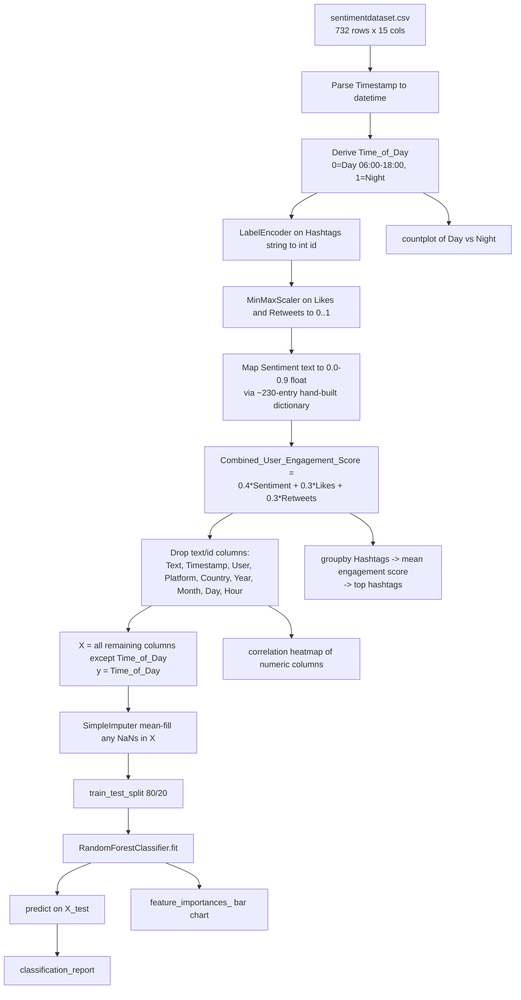

# Social Media Engagement Analyzer — Project Explanation

Repo: https://github.com/anujeshify/Social-Media-Engagement-Analyzer
Main notebook: `social_media_engagement_analyzer.ipynb` (the earlier `Social Media Engagement Analyzer.ipynb` is a shorter draft of the same pipeline, without the visualization cells).


## 1. What the project does

It takes a CSV of ~732 social media posts (text, sentiment label, likes, retweets, hashtags, timestamp, platform, country) and:

1. Engineers a **combined engagement score** per post from sentiment + likes + retweets.
2. Engineers a binary **Time_of_Day** label (Day / Night) from the post timestamp.
3. Trains a **RandomForestClassifier** to predict Day vs. Night from the other features.
4. Produces four charts (post-time distribution, correlation heatmap, feature importance, top hashtags) and prints the model's classification report and the top engagement hashtags.

There is no "target metric" the project is actually trying to optimize for engagement — Time_of_Day is the ML target, and engagement score is a separate, purely arithmetic ranking used only for the hashtag analysis at the end. That's worth knowing going in, because the README's framing ("analyze engagement") and the actual ML target (Day/Night) are two different things.

## 2. End-to-end pipeline



## 3. Step-by-step walkthrough of the notebook

### Cell 0 — Imports
`pandas`, `scikit-learn` (`train_test_split`, `LabelEncoder`, `MinMaxScaler`, `RandomForestClassifier`, `classification_report`, `SimpleImputer`), `matplotlib`, `seaborn`. Standard tabular-ML/plotting stack, nothing exotic.

### Cell 1 — Google Colab mount (commented out)
Alternate loading path for Colab users who keep the CSV on Google Drive. Not used when running locally.

### Cell 2 — Load data
```python
df = panda.read_csv('sentimentdataset.csv')
```
Reads the 732-row dataset. Columns: two junk index columns (`Unnamed: 0.1`, `Unnamed: 0`), `Text`, `Sentiment`, `Timestamp`, `User`, `Platform`, `Hashtags`, `Retweets`, `Likes`, `Country`, `Year`, `Month`, `Day`, `Hour`.

### Cell 3 — Derive `Time_of_Day`
```python
df['Timestamp'] = panda.to_datetime(df['Timestamp'])
df['Time_of_Day'] = df['Timestamp'].dt.hour.apply(lambda x: 0 if 6 <= x < 18 else 1)
```
This is the **ML target**: 0 = posted between 6am–6pm ("Day"), 1 = posted 6pm–6am ("Night"). It's derived purely from the hour, so it's a deterministic label, not something inherently hard to predict — the classifier is really learning "do likes/retweets/hashtag/sentiment patterns correlate with the hour someone posted," which is a weak signal at best (see Results below).

### Cell 4 — Encode hashtags
```python
lab_enc = LabelEncoder()
df['Hashtags'] = lab_enc.fit_transform(df['Hashtags'])
```
Each distinct raw hashtag **string** (e.g. `"#Nature #Park   "`, whitespace and all) gets mapped to an arbitrary integer ID. Because almost every row has a unique hashtag pair, this is effectively a row identifier with ~600+ distinct values, not a meaningful numeric feature — the model can't generalize from "hashtag ID 491" to "hashtag ID 492." `lab_enc` is kept around so `lab_enc.inverse_transform(...)` can turn IDs back into readable hashtags later.

### Cell 5 — Normalize Likes/Retweets
```python
scale = MinMaxScaler()
df[['Likes', 'Retweets']] = scale.fit_transform(df[['Likes', 'Retweets']])
```
Rescales both columns to [0, 1] using this dataset's own min/max — fine for training but means the scaler is not reusable as-is on new data with a different range (it isn't saved/pickled anywhere).

### Cell 6 — Inspect distinct sentiment labels
The dataset does **not** use a clean 3-class (Positive/Negative/Neutral) sentiment scheme. It has ~230 distinct free-text emotion labels with inconsistent whitespace (e.g. `' Positive  '` vs `' Positive '` vs `' Positive'` are all technically different strings). This cell just prints them so the next cell's mapping dictionary can be built.

### Cell 7 — Map sentiment to a 0–0.9 score
A hand-built dictionary maps ~230 whitespace-sensitive label variants (`'Love'→0.9`, `'Joy'→0.8`, `'Anger'→0.1`, `'Neutral'→0.5`, etc.) to a float "positivity" score. This is a manual sentiment-polarity lookup, not a trained sentiment model. **Caveat found while reading it closely:** because the dictionary keys must match exact whitespace and the printed list in cell 6 shows many near-duplicate keys, any label variant not present in the dictionary maps to `NaN` — which is exactly what `SimpleImputer` in cell 11 is there to paper over (it mean-fills those NaNs rather than the labels being deliberately treated as missing data).

### Cell 8 — Combined engagement score
```python
weights = {'Sentiment': 0.4, 'Likes': 0.3, 'Retweets': 0.3}
df['Combined_User_Engagement_Score'] = (
    df['Sentiment'] * weights['Sentiment']
  + df['Likes']     * weights['Likes']
  + df['Retweets']  * weights['Retweets']
)
```
A simple weighted sum — sentiment counts 40%, likes and retweets 30% each (both already normalized to [0,1] from cell 5, and sentiment is already on a 0–0.9 scale from cell 7). The weights are hand-picked, not learned or validated against any external "true engagement" measure.

### Cell 9 — Drop unused columns
Drops `Unnamed: 0`, `Text`, `Timestamp`, `User`, `Platform`, `Country`, `Year`, `Month`, `Day`, `Hour` — i.e. everything that isn't numeric-ready or that would leak the target directly (`Hour` is dropped because `Time_of_Day` was derived from it; keeping `Hour` would make the classification trivial). `Unnamed: 0.1` (the original row index, 0–731) is **not** dropped and stays in the feature set.

### Cell 10 — Build X / y
```python
X = df.drop(['Time_of_Day'], axis=1)   # Unnamed: 0.1, Sentiment, Hashtags, Retweets, Likes, Combined_User_Engagement_Score
y = df['Time_of_Day']
```

### Cell 11 — Impute missing values
`SimpleImputer(strategy='mean')` fills any NaN in `X` (mainly the unmapped-sentiment NaNs from cell 7) with that column's mean.

### Cell 12 — Train/test split
`train_test_split(X, y, test_size=0.2, random_state=42)` → 585 train / 147 test rows. Note `random_state` is fixed for the split but **not** passed to the model in cell 13, so the model's own outputs vary slightly run to run (confirmed below).

### Cell 13 — Train the model
`RandomForestClassifier()` with all-default hyperparameters (100 trees, no max depth, no class weighting) fit on the training set.

### Cell 14 — Visualization: Time-of-Day distribution
`sns.countplot` of `Time_of_Day` → bar chart, Day (~455 posts) vs Night (~277 posts). Confirms the classes are imbalanced roughly 62/38, which matters when reading the classification report below.

### Cell 15 — Visualization: correlation heatmap
`sns.heatmap(df.corr(), annot=True)` over the final numeric dataframe.

### Cell 16 — Visualization: feature importance
Plots `model.feature_importances_` as a horizontal bar chart, largest 10 (there are only 6 features, so all are shown).

### Cell 17 — Evaluate the model
`classification_report(y_test, y_prediction)` — precision/recall/F1 for class 0 (Day) and class 1 (Night).

### Cell 18 — Top hashtags by engagement
```python
df.groupby('Hashtags')['Combined_User_Engagement_Score'].mean().idxmax()
```
Finds which hashtag-ID group has the highest average engagement score, then `lab_enc.inverse_transform` decodes it back to the original hashtag text. Since almost every hashtag pair is unique to one post, this "average" is usually an average of a single row — it's really just "which single post scored highest," not a statistically meaningful hashtag trend.

### Cell 19 — Visualization: top-10 hashtags bar chart
Same idea as cell 18, plotted for the top 10 groups.

## 4. Results (reproduced by actually running the notebook)

I cloned the repo, created a virtualenv, installed `pandas`, `scikit-learn`, `matplotlib`, `seaborn`, `jupyter`/`nbconvert`, and executed `social_media_engagement_analyzer.ipynb` end-to-end with `jupyter nbconvert --execute`. It completed with no errors. Output on this run:

```
              precision    recall  f1-score   support
           0       0.74      0.85      0.79        86
           1       0.73      0.57      0.64        61
    accuracy                           0.73       147
```
(README reports 0.71 accuracy from the authors' own run — the ~2 point difference is expected since `RandomForestClassifier()` has no `random_state`, so tree structure varies between runs even with a fixed train/test split.)

```
Top Hashtag pair for Maximum User Engagement:  #Elation #RareBookDiscovery
Other Hashtags which can maximise user engagement:
 #Anticipation #AdventureAwaits
 #Motivation #FitnessGoals
 #Wonder #StargazingAdventure
 #HeartwarmingMoments #SeniorFamily
 #QuietMoments #BookishEscape
```

### Reading the feature importance chart (`Visualization/rfc.png`)


The most important "feature" the model found is `Unnamed: 0.1` — the raw row index from the original CSV — followed by `Hashtags` (the near-unique label-encoded ID). Both are `~30%+` importance individually and together account for over 60% of the model's decisions. This is a strong signal that the model is partly fitting to **row order / row identity** rather than genuine behavioral signal (likes, retweets, sentiment only contribute the remaining ~35% combined) — a classic case of an identifier column leaking into the feature set. If you rerun this project, dropping `Unnamed: 0.1` before training would give a more honest read of whether sentiment/likes/retweets actually predict posting time.

### Correlation heatmap (`Visualization/corr.png`)


Likes and Retweets are correlated at 1.00 (they were both derived from the same MinMaxScaler call and are highly linearly related in the source data), and both correlate ~0.77 with the engagement score by construction (they're 60% of its formula). `Time_of_Day` correlates weakly (≤0.2) with everything — consistent with the model's mediocre accuracy on the two classes.

### Time-of-day distribution (`Visualization/tod.png`)


~455 Day posts vs ~277 Night posts — a 62/38 class imbalance, which is why the model's recall on class 1 (Night, 0.56–0.57) is noticeably worse than class 0 (Day, 0.83–0.85): with default settings, `RandomForestClassifier` biases toward the majority class.

### Top hashtags by engagement (`Visualization/tophash.png`)


As noted in the cell-18 walkthrough, each bar is dominated by one or two posts rather than a genuine multi-post trend, because hashtag pairs are almost all unique.

## 5. How to run it yourself

```bash
git clone https://github.com/anujeshify/Social-Media-Engagement-Analyzer.git
cd Social-Media-Engagement-Analyzer
python -m venv .venv
.venv\Scripts\activate        # Windows
pip install pandas scikit-learn matplotlib seaborn jupyter nbconvert
jupyter notebook social_media_engagement_analyzer.ipynb   # run cells top to bottom
```
`sentimentdataset.csv` must stay in the same folder as the notebook (it's read with a relative path).

## 6. Summary of what's solid vs. what to watch out for

**Solid:** clean linear pipeline (load → clean → engineer → scale → train → evaluate → visualize), reproducible end to end, dataset ships in the repo so it runs with zero external setup.

**Watch out for:**
- `Unnamed: 0.1` (row index) is left in the feature set and turns out to be the single most "important" feature — likely index leakage rather than a real predictor.
- `Hashtags` is label-encoded but is almost row-unique, so it behaves like an ID column, not a categorical feature the model can generalize over.
- The ~230-entry sentiment-to-score dictionary is manually curated and whitespace-sensitive; unmatched labels silently become NaN and get mean-imputed rather than flagged.
- `RandomForestClassifier()` has no `random_state`, so reported accuracy (0.71–0.73 across runs) isn't exactly reproducible run-to-run, only the train/test split is.
- The 62/38 class imbalance in `Time_of_Day` is not addressed (no class weighting/resampling), which shows up as weaker recall on the minority "Night" class.
